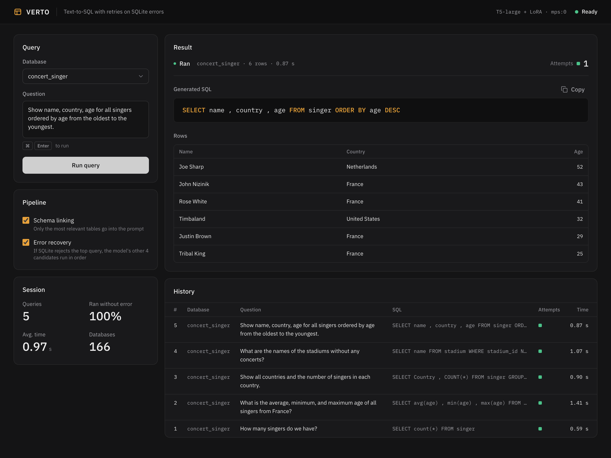
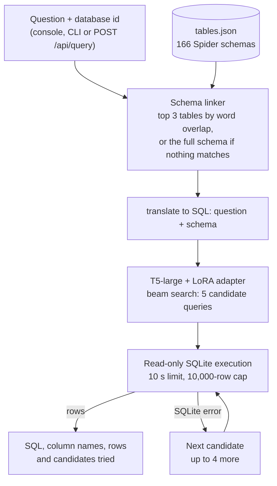

# VERTO: Natural Language Database Interface Engine

**VERTO** turns plain-English questions into SQL and runs them against the 166 SQLite databases of the [Spider](https://yale-lily.github.io/spider) benchmark. A T5-large model fine-tuned with LoRA writes the query. A schema linker gives it only the tables that look relevant to the question, and when the SQL fails to run, the model's next-best candidate queries run in turn until one works.

It needs no API keys. One command trains it on a Google Cloud L4 GPU, or train it yourself on a CUDA GPU or Apple silicon. It serves on a GPU or the CPU through a web console, a REST API and a `verto` command-line tool.

---

## Console



---

## How It Works



* **Schema linking** ([`engine/schema.py`](verto/engine/schema.py)): the question and every table and column name are split into lowercase words, with a trailing *s* removed. Each table scores 2 points for every word its name shares with the question and 1 for every word a column name shares. The top 3 tables go into the prompt with `[PK]` and `[FK -> table.col]` markers; if no word matches, the whole schema goes in. On the dev set this makes prompts 18.9% shorter (median). Turn it off with `--no-schema-linking` or the console's *Schema linking* box.
* **Generation** ([`engine/model.py`](verto/engine/model.py)): T5-large with a LoRA adapter (rank 16, alpha 32) on the attention query and value projections: 4.7 million trainable parameters, 0.64% of the model. The server merges the adapter into the weights when it loads, so generating costs the same as the base model. Beam search uses 5 beams, and prompts are cut at 1,024 tokens. T5's vocabulary has no `<`, so prompts and training targets spell it `&lt;` and the generated SQL is turned back.
* **Error recovery** ([`engine/inference.py`](verto/engine/inference.py), [`engine/executor.py`](verto/engine/executor.py)): the SQL runs on a read-only SQLite connection that can't attach other files, with a 10-second limit and a 10,000-row cap. Beam search writes 5 candidate queries in one pass, best first. The top one runs first; if SQLite rejects it, the others run in order until one works, so recovery needs no extra model calls. With recovery off, the top query is the only try. The response reports how many candidates ran, and the console draws one square per candidate.
* **Serving** ([`api/main.py`](verto/api/main.py), [`cli.py`](verto/cli.py)): FastAPI serves `GET /api/health`, `GET /api/databases`, `POST /api/query` and the console. Queries run in a worker thread and the engine generates one at a time, so the server keeps answering health checks while the model works. The CLI either loads the engine itself (`--local`) or calls a running server.

---

## Evaluation

Measured on 2026-11-17 on an NVIDIA L4, with the checkpoint from the 5-epoch run under [Training](#training). Every number below is in [`results/spider_dev_eval.json`](results/spider_dev_eval.json).

| Spider dev set: 1,034 questions on 20 databases | |
|---|---|
| **Execution accuracy** | **57.9%** |
| Exact match | 34.9% |
| Final SQL still failed to run | 12.7% |
| Top query failed to run | 246 questions: another candidate ran for 115 of them (47%), and 47 of those were right |
| Schema linking | prompts 18.9% shorter (median; mean 19.4%) |
| Time per question | median 1.24 s, 90th percentile 2.62 s |

Reproduce it with the checkpoint in `checkpoints/best_model.pt` and the Spider data in `data/spider`:
```bash
python scripts/train.py --eval-only      # writes results/spider_dev_eval.json
```

The evaluation sends every dev question through `NLDIEngine.query()`, the same path the server uses, with schema linking and error recovery on. *Exact match* compares the predicted and gold SQL after lowercasing and collapsing whitespace, which is stricter than Spider's official exact-set match. *Execution accuracy* runs both queries and compares the rows they return, in order when the gold query has an `ORDER BY` and as multisets otherwise. The 20 dev databases never appear in training.

Accuracy can be improved further if needed, for example by training for more epochs: the validation loss was still falling after the fifth (0.28, 0.20, 0.15, 0.13, 0.11).

---

## Training

[`scripts/train.py`](scripts/train.py) fine-tunes the adapter on Spider's 7,000 training questions (90% for training, 10% for validation, split with a fixed seed). It keeps the epoch with the lowest validation loss in `checkpoints/best_model.pt`, the adapter weights and their LoRA settings (about 19 MB), then runs the evaluation above:

```bash
python scripts/train.py                                                      # defaults: 20 epochs, batch 4 x 8, lr 5e-5
python scripts/train.py --epochs 5 --lr 1e-3 --batch-size 8 --grad-accum 2   # the run evaluated above
```

* **Batches are padded to their own longest prompt**, and prompts of similar length are batched together. An epoch takes about 48 minutes on an Apple M4 and 12 minutes on an L4.
* **Device**: CUDA, then Apple silicon (MPS), then the CPU; `--device` overrides it. Training uses bfloat16 on Ampere-or-newer GPUs and on Apple silicon, and float32 elsewhere, because T5 overflows in float16.
* **Memory**: training takes about 7 GB of GPU memory, so on a 16 GB laptop with other apps open, macOS starts swapping and training slows down. The cloud run below avoids that.

### On a Google Cloud L4

[`scripts/gcp_run.sh`](scripts/gcp_run.sh) runs the training and the evaluation on a `g2-standard-8` VM (one NVIDIA L4, 32 GB of RAM, about $0.85/hr on demand) billed to your project:

```bash
gcloud init                          # sign in; pick a project linked to your billing account
python scripts/setup_data.py         # the Spider data the VM trains on
bash scripts/gcp_run.sh preflight    # read-only: APIs and GPU quota
bash scripts/gcp_run.sh              # upload, train, evaluate, download
```

* **What it runs**: `scripts/train.py --device cuda` with `TRAIN_ARGS` (default `--epochs 5 --lr 1e-3 --batch-size 8 --grad-accum 2`), on your working tree as it is, uncommitted changes included, with the exact versions in `requirements.txt`. The Spider data is uploaded to a bucket in your project once and reused.
* **What comes back**: `checkpoints/best_model.pt` (any checkpoint already there is renamed, not overwritten), `results/spider_dev_eval.json` and the run's log in `logs/`.
* **Clean-up is automatic**: the VM uploads its results and deletes itself. GCP also deletes it after `MAX_HOURS` (default 3) whatever happens, so a hung run can't keep billing.
* **Evaluating without training**: `TRAIN_ARGS=--eval-only bash scripts/gcp_run.sh` uploads `checkpoints/best_model.pt` and only runs the evaluation. Each line of `TRAIN_ARGS` is one `train.py` run.
* **Time and cost**: the default run takes about 1.5 hours of VM time (62 minutes of training, 26 of evaluation), roughly $1.30 at the on-demand price. An evaluation-only run takes about 30 minutes, roughly $0.42.
* **Sold-out zones**: L4s often are. `up` tries every L4 zone across five US and two Canadian regions and keeps retrying for `RETRY_MINUTES` (default 60). `SPOT=1` is about 60% cheaper, but a preemption loses the run.

---

## Quickstart

Python 3.10 or newer (`requirements.txt` was tested on 3.12).

```bash
python -m venv .venv
source .venv/bin/activate
pip install -r requirements.txt && pip install -e .     # the tested versions; or: pip install -e ".[local]"
python scripts/setup_data.py                            # Spider: 166 SQLite databases, about 880 MB
uvicorn verto.api.main:app --port 8000
```

Open http://localhost:8000, choose `concert_singer` and ask, for example, *"How many singers are older than 30?"*

* **First start**: T5-large (about 3 GB) downloads from Hugging Face once.
* **The checkpoint** isn't in git. Train one (see [Training](#training)) or copy one to `checkpoints/best_model.pt`. Without it the server runs the base T5-large model, which doesn't write SQL, and the console's status line says *no checkpoint*.
* **Device**: CUDA, then Apple silicon (MPS), then the CPU. Set `VERTO_DEVICE` to choose.
* **Speed**: on an Apple M4, the server starts in about 9 seconds once T5-large is cached, and the questions in the screenshot took 0.5 to 1.5 seconds each on the GPU (MPS).

### Command line

```bash
verto --local --list-dbs                                                  # reads tables.json; doesn't load the model
verto --local --db concert_singer "How many singers are older than 30?"   # loads the model in this process

export VERTO_SERVER_URL=http://localhost:8000                             # or a server on another machine
verto --health
verto --db concert_singer --json "What are the names of all singers?"
```

To call a running server, the CLI needs only the Python standard library: `pip install -e .` without extras is enough. `--local` never falls back to a server; it needs the model packages and the Spider data on this machine.

---

## Deployment on AWS (Terraform)

```bash
cd terraform
cp terraform.tfvars.example terraform.tfvars    # set allowed_cidr to your IP
terraform init && terraform apply
terraform output -raw dashboard_url
```

The stack is one EC2 instance (Ubuntu 22.04 on a `t3.xlarge` with 16 GB of memory and a 40 GB disk, by default) and a security group that admits only `allowed_cidr`, on SSH and the API port. On first boot the instance clones this repository from GitHub, so push your changes first. It installs the pinned requirements under Python 3.12, downloads the Spider data, and runs the API as a systemd service that restarts after a crash or a reboot.

* **The checkpoint**: set `checkpoint_url` to a URL the instance can download `best_model.pt` from, such as a GitHub release asset, or copy the file to `/opt/VERTO/checkpoints/` and run `sudo systemctl restart verto`. Until then the server runs the base model.
* **GPU instances**: for a `g4dn.xlarge` (NVIDIA T4), set `ami_id` to an AWS Deep Learning AMI. The stock Ubuntu image has no NVIDIA driver, so torch would run on the CPU.
* **Exposure**: the API speaks plain HTTP with no authentication. Keep `allowed_cidr` narrow, or put the API behind a proxy that adds HTTPS and logins.

---

## Configuration Reference

| Variable | Default | Purpose |
|:---|:---|:---|
| `VERTO_CHECKPOINT` | `checkpoints/best_model.pt` | LoRA adapter weights to load |
| `VERTO_SPIDER_DIR` | `data/spider` | Spider root, containing `tables.json` and `database/` |
| `VERTO_DEVICE` | CUDA, then MPS, then CPU | Torch device: `cuda`, `mps` or `cpu` |
| `VERTO_SERVER_URL` (or `VERTO_API_URL`) | — | Server the `verto` CLI sends questions to |
| `VERTO_HOST`, `VERTO_PORT` | `0.0.0.0`, `8000` | Bind address for `scripts/run_cloud.py`; with `uvicorn`, pass `--host` and `--port` |
| `NGROK_AUTHTOKEN` | — | Token for `scripts/run_cloud.py --ngrok` (`pip install -e ".[ngrok]"`) |

---

## Repository Structure

```text
VERTO/
├── verto/
│   ├── cli.py                  # `verto` command: local engine or HTTP client
│   ├── config.py               # Settings read from environment variables
│   ├── api/
│   │   ├── main.py             # FastAPI app: /api/health, /api/databases, /api/query and the console
│   │   ├── models.py           # Pydantic request and response models
│   │   └── client.py           # Standard-library HTTP client the CLI uses for a remote server
│   └── engine/
│       ├── inference.py        # NLDIEngine: schema linking, generation, execution and error recovery
│       ├── model.py            # T5-large + LoRA loading and beam-search generation
│       ├── schema.py           # tables.json parsing and the schema linker
│       └── executor.py         # Read-only SQLite execution and SQL normalization
├── scripts/
│   ├── setup_data.py           # Download Spider and check it is complete
│   ├── train.py                # LoRA fine-tuning and the Spider dev evaluation
│   ├── gcp_run.sh              # Train and evaluate on a Google Cloud L4 VM
│   ├── gcp_vm_startup.sh       # What that VM runs at boot
│   └── run_cloud.py            # Start the server and print the CLI connection command (optional ngrok tunnel)
├── web/                        # Console: index.html, style.css, app.js and IBM Plex fonts
├── tests/test_verto.py         # Unit tests
├── terraform/                  # One EC2 instance and its security group
├── results/                    # spider_dev_eval.json: the numbers above
├── requirements.txt            # Exact tested versions
├── checkpoints/                # best_model.pt goes here (not in git)
└── data/spider/                # Spider data from setup_data.py (not in git)
```

---

## Running Automated Tests

```bash
pip install -e ".[dev]"
pytest      # no model or Spider data needed; without torch, the one test that needs it is skipped
```

---

## Limitations

* **A query that runs can still be wrong.** Recovery only checks that SQLite accepts a candidate. Of the 115 failed top queries it replaced with one that ran, 47 returned the right rows.
* **Schema linking is lexical.** It matches words, not meanings (*"compensation"* won't find `salary`), keeps at most 3 tables and doesn't add the bridge tables a join needs, so a foreign-key marker can point at a table that isn't in the prompt. Training uses the full schema, while serving uses the linked one by default.
* **Long schemas are truncated.** 242 of the 7,000 training prompts (3.5%) are longer than 1,024 tokens with the full schema.
* **One query at a time.** The engine generates one query at a time; others wait their turn.
* **No authentication.** Anyone who can reach the API can run queries on the model.

---

## License

This project is licensed under the MIT License - see the [LICENSE](LICENSE) file for details.
